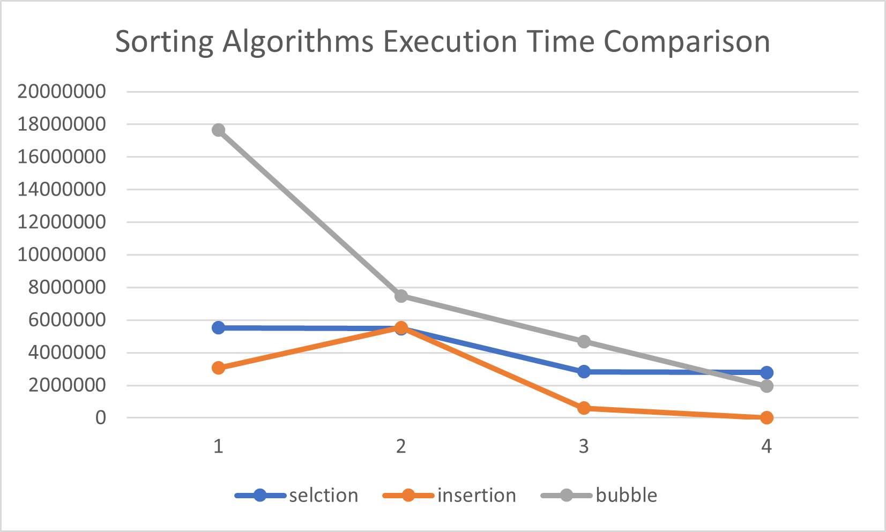

# Sorting-Algorithms-Benchmark

## 1. Student Information

- **Student Name:** [Mahmoud fituri]
- **University ID:** [3167122]
- **Section Number:** [DSA Group C]
- **Programming Language:** Java
- **Array Size:** 100,000 integers

## 2. Project Description

This project compares the execution time of five sorting algorithms using four different input cases.

### Sorting Algorithms
1. Selection Sort
2. Insertion Sort
3. Bubble Sort

### Input Cases
- Random: Randomly ordered integers.
- Reverse Sorted: Integers arranged from largest to smallest.
- Partially Sorted: Approximately 80% of the data is sorted.
- Fully Sorted: Integers arranged from smallest to largest.

## 3. Experimental Method

The program uses `System.nanoTime()` to measure execution time.

Execution time is calculated in microseconds using:

`Execution Time (µs) = (End Time - Start Time) / 1000`

Each algorithm receives an independent copy of the original input array. Array copying is excluded from the measured execution time.

## 4. Benchmark Results

Replace the placeholders with the actual measurements from your Java program.

| Algorithm | Random (µs) | Reverse (µs) | Partial (µs) | Sorted (µs) |
|---|---:|---:|---:|---:|
| Selection Sort | [5526296] | [5469055] | [2824550] | [2786715] |
| Insertion Sort | [3061897] | [5540674] | [599324] | [127] |
| Bubble Sort | [17639728] | [7477155] | [4682970] | [1948000] |

## 5. Performance Analysis

### Selection Sort

Selection Sort repeatedly finds the smallest element in the unsorted portion of the array and places it in the correct position.

Time complexity: O(N²)

Its number of comparisons is approximately quadratic regardless of the initial order of the data.

It performs a relatively small number of swaps.

### Insertion Sort

Insertion Sort builds a sorted portion of the array by inserting each element into its correct position.

Average and worst-case time complexity: O(N²)

Best-case time complexity: O(N) for already sorted data.

It can perform well on sorted or nearly sorted arrays.

### Bubble Sort

Bubble Sort repeatedly compares adjacent elements and swaps them when they are in the wrong order.

Average and worst-case time complexity: O(N²)

Best-case time complexity: O(N) if an early-stop optimization is implemented.

Its performance can be poor on large, randomly ordered or reverse-sorted arrays.

## 6. Comparison of Algorithms

Selection Sort and Bubble Sort generally perform many comparisons, even when the array is already sorted.

Insertion Sort can be considerably faster when the input is already sorted or nearly sorted because it requires fewer element shifts.

For large arrays, these three algorithms can take a long time because their average or worst-case time complexity is O(N²).

## 7. Best Performing Algorithm

Based on the actual benchmark results, identify the fastest algorithm for each case:

Random: [Insertion]

Reverse Sorted: [Selection]

Partially Sorted: [Insertion]

Fully Sorted: [Insertion]

These conclusions should be based on the measured execution times rather than theoretical expectations alone.

## 8. Conclusion

This project compares Selection Sort, Insertion Sort, and Bubble Sort under different input conditions.

The experiment demonstrates how the initial arrangement of data can affect execution time, particularly for Insertion Sort and optimized Bubble Sort. The results also illustrate the limitations of quadratic-time sorting algorithms when processing large arrays.

## Performance Chart

The chart compares the execution time of Selection Sort,
Insertion Sort, and Bubble Sort across four input cases.

